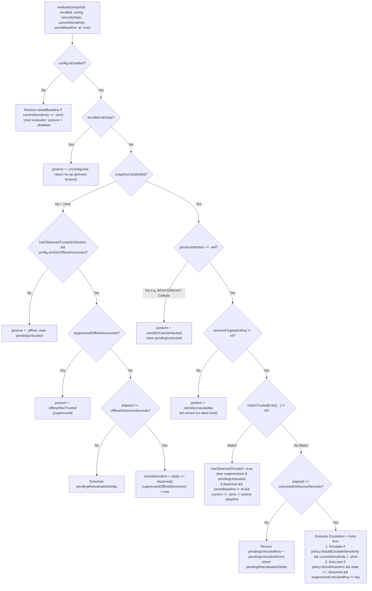

# Trusted Wi-Fi Network Boundary Sentinel — Architecture Specification

**Branch:** `feat/trusted-wifi-boundary`  
**Worktree:** `/Users/stevew/Documents/Pupil-worktrees/wifi`  
**Target Platform:** macOS 14.0+ (Swift 6.0 strict concurrency, `@MainActor` + `Sendable`)

---

## 1. Executive Summary & Threat Model

The **Trusted Wi-Fi Network Boundary Sentinel** is an opt-in, privacy-preserving security policy for Pupil. When enabled (`trustedNetworkAutoArmEnabled = true`) and at least one trusted Wi-Fi network is enrolled, Pupil monitors network transitions continuously and protects the MacBook when leaving trusted environments (e.g., home or office Wi-Fi) or joining untrusted public Wi-Fi (e.g., coffee shops, libraries, airports).

### Core Security & Privacy Invariants

1. **Opt-In & Fail-Safe Unconfigured Guard:** Disabled by default (`trustedNetworkAutoArmEnabled = false`). Even when enabled, if `trustedNetworks` is empty, `TrustedNetworkEvaluator` returns `.unconfigured` and **never** auto-arms or escalates sensitivity (preventing accidental self-lockout during initial setup).
2. **Never Auto-Disarm on Wi-Fi Reconnection:** Returning to a trusted Wi-Fi network **must never** disarm an `.armed`, `.tamperPending`, or `.alarm` session. Wi-Fi SSIDs can be trivially spoofed by an Evil Twin access point or mobile hotspot; disarming always requires Keychain PIN, Touch ID, Mac owner password, paired BLE proximity (if separately enabled), or authenticated remote phone disarm.
3. **Authoritative SSID Mismatch Precedence:** When both the live network snapshot and an enrolled `TrustedNetworkEntry` have an `ssidHash`, `ssidHash` comparison is authoritative. A mismatch **never** falls back to `gatewayMACHash` or `interfaceHash` (preventing false trust if two different networks both use `192.168.1.1/24`).
4. **Fail-Closed Interface Fingerprint Guard:** When CoreWLAN SSID/BSSID access is unavailable (e.g., Location permission not granted on macOS 14+), fallback identification uses `gatewayMACHash` (router ARP MAC) first, then `interfaceHash`. `NetworkIdentifierHasher.hashInterface(...)` **requires at least one network-scoped attribute** (`routerIP`, `subnetCIDR`, or `dhcpServerID`). It must never hash `interfaceName` (e.g., `"en0"`) alone, because that would collide across all Wi-Fi networks. If no distinguishing attribute is readable (e.g., strict sandbox restriction), the snapshot resolves to `.identityUnavailable` and fails closed (does not mark as trusted).
5. **Monotonic Sensitivity Escalation & Reversible Baseline:** Escalating sensitivity to Strict upgrades `.relaxed` or `.balanced` $\rightarrow$ `.strict`, while preserving `.ultra` (never downgrades `.ultra` to `.strict`). The pre-escalation sensitivity is persisted in `PupilSettings.trustedNetworkBaselineGazeSensitivity` so returning to a trusted network (or disabling the policy) restores the user's prior setting cleanly—unless the user manually selected a different sensitivity while away.
6. **Zero PII / Location Leakage in Logs:** Raw SSIDs, BSSIDs, gateway MACs, and IP addresses are never passed into `TrustedNetworkEvaluator` or written to `SecurityEventRecord.detail` / `TamperJournalStore` Markdown exports. Only user-assigned/sanitized labels and cryptographic SHA-256 digests (`CryptoKit`) are persisted and compared. CoreLocation coordinates (`CLLocation`, `startUpdatingLocation()`) are **never** requested.

---

## 2. Build, Bundle & Permission Prerequisites

### 2.1 `Package.swift`

Add the three Apple system frameworks to the `Pupil` executable target's `linkerSettings`:

```swift
.linkedFramework("CoreWLAN"),
.linkedFramework("CoreLocation"),
.linkedFramework("SystemConfiguration")
```

### 2.2 `scripts/bundle-app.sh` (`Info.plist`)

macOS 14+ requires Location Services authorization for `CWInterface.ssid()` and `CWInterface.bssid()`, and `CLLocationManager.requestWhenInUseAuthorization()` silently no-ops unless `NSLocationWhenInUseUsageDescription` is present in `Info.plist`.

Add the following key to the `Info.plist` heredoc in `scripts/bundle-app.sh`:

```xml
<key>NSLocationWhenInUseUsageDescription</key>
<string>Pupil uses Location permission solely to read your current Wi-Fi network name (SSID) so it can recognize trusted networks. Your physical location coordinates are never collected, stored, or transmitted.</string>
```

### 2.3 Headless Test Runner & Unbundled Execution Safety

Just as `CameraManager.isCaptureEnabled` protects `swift test` from TCC `SIGABRT` crashes when `NSCameraUsageDescription` is missing, `TrustedNetworkMonitor` must enforce:

- `TrustedNetworkMonitor.isLiveSystemAccessEnabled`: evaluates `true` only when not running under `XCTest` / Swift Testing (`NSClassFromString("XCTestCase") == nil && ProcessInfo.processInfo.environment["XCTestConfigurationFilePath"] == nil`) — and additionally checks `Bundle.main.object(forInfoDictionaryKey: "NSLocationWhenInUseUsageDescription") != nil` before ever invoking `CLLocationManager.requestWhenInUseAuthorization()`.
- Calling `CLLocationManager().authorizationStatus` without `requestWhenInUseAuthorization()` never prompts or crashes, and if running unbundled/in tests, `LocationPermissionState` resolves cleanly to `.unavailableInTest` without calling CoreLocation prompt APIs.

---

## 3. Types, Protocols, and Data Models

Create two core files in `Sources/Pupil/Core/`:
1. `Sources/Pupil/Core/TrustedNetworkEvaluator.swift` — pure `Sendable` models, SHA-256 canonical hasher, and `TrustedNetworkEvaluator` state machine.
2. `Sources/Pupil/Core/TrustedNetworkMonitor.swift` — `TrustedNetworkIdentityProviding` protocol, `SystemNetworkIdentityProvider` (CoreWLAN / NWPath / CoreLocation / SystemConfiguration / BSD ARP), and `@MainActor @Observable TrustedNetworkMonitor`.

### 3.1 Policy & Classification Enums

```swift
public enum TrustedNetworkPolicyMode: String, CaseIterable, Identifiable, Codable, Sendable {
    case autoArmAndEscalate = "autoArmAndEscalate"
    case autoArmOnly = "autoArmOnly"
    case escalateToStrictOnly = "escalateToStrictOnly"

    public var id: String { rawValue }

    public var title: String {
        switch self {
        case .autoArmAndEscalate: return "Arm and set sensitivity to Strict"
        case .autoArmOnly: return "Arm Pupil only"
        case .escalateToStrictOnly: return "Set sensitivity to Strict only"
        }
    }

    public var subtitle: String {
        switch self {
        case .autoArmAndEscalate:
            return "Starts arming Pupil and upgrades gaze detection to Strict when on untrusted Wi-Fi."
        case .autoArmOnly:
            return "Starts arming Pupil on untrusted Wi-Fi without changing gaze sensitivity."
        case .escalateToStrictOnly:
            return "Upgrades gaze detection to Strict on untrusted Wi-Fi without auto-arming."
        }
    }

    public var shouldAutoArm: Bool {
        self == .autoArmAndEscalate || self == .autoArmOnly
    }

    public var shouldEscalateSensitivity: Bool {
        self == .autoArmAndEscalate || self == .escalateToStrictOnly
    }
}

public enum NetworkFingerprintSource: String, Codable, Sendable, Equatable {
    case ssid = "ssid"
    case gatewayMAC = "gatewayMAC"
    case interfaceHash = "interfaceHash"
    case unavailable = "unavailable"

    public var displayTitle: String {
        switch self {
        case .ssid: return "Wi-Fi SSID"
        case .gatewayMAC: return "Router gateway MAC"
        case .interfaceHash: return "Interface & subnet fingerprint"
        case .unavailable: return "Unavailable"
        }
    }
}

public enum LocationPermissionState: String, Codable, Sendable, Equatable {
    case notDetermined
    case authorized
    case denied
    case restricted
    case servicesDisabled
    case unavailableInTest

    public var canReadSSID: Bool {
        self == .authorized
    }
}
```

### 3.2 Privacy-Preserving Hashing (`NetworkIdentifierHasher`)

```swift
import CryptoKit
import Foundation

public enum NetworkIdentifierHasher: Sendable {
    /// Normalizes a MAC/BSSID string ("AA-bb-0C-dd-ee-ff" or "aa:bb:c:dd:ee:ff")
    /// to lowercase 2-digit colon-delimited hex ("aa:bb:0c:dd:ee:ff").
    /// Rejects all-zero ("00:00:00:00:00:00") and broadcast ("ff:ff:ff:ff:ff:ff") placeholders.
    public static func canonicalizeMAC(_ raw: String?) -> String?

    /// Computes domain-separated SHA-256 hex digest of an exact case-sensitive Wi-Fi SSID.
    /// Returns nil if `ssid` is nil or empty after trimming NUL bytes.
    public static func hashSSID(_ ssid: String?) -> String?
    // Input format: "pupil.wifi.ssid.v1|\(ssid)"

    /// Computes domain-separated SHA-256 hex digest of a canonicalized AP BSSID.
    public static func hashBSSID(_ bssid: String?) -> String?
    // Input format: "pupil.wifi.bssid.v1|\(canonicalMAC)"

    /// Computes domain-separated SHA-256 hex digest of the default gateway's L2 MAC address.
    /// Fallback Tier 1 when CoreLocation permission prevents SSID/BSSID access.
    public static func hashGatewayMAC(_ gatewayMAC: String?) -> String?
    // Input format: "pupil.wifi.gw.v1|\(canonicalMAC)"

    /// Computes IPv4 network prefix CIDR string (e.g. "192.168.1.0/24") from local IPv4 + mask.
    /// Avoids using host IP directly so DHCP lease renewals do not invalidate trust.
    public static func ipv4SubnetCIDR(address: String?, netmask: String?) -> String?

    /// Computes domain-separated SHA-256 hex digest from Wi-Fi interface + L3/DHCP metadata.
    /// Fallback Tier 2 when both SSID and gateway ARP MAC are unavailable.
    /// FAIL-CLOSED: Returns `nil` unless at least one network-scoped field
    /// (`routerIP`, `subnetCIDR`, or `dhcpServerID`) is non-empty.
    public static func hashInterfaceFingerprint(
        interfaceName: String,
        localHardwareMAC: String?,
        routerIP: String?,
        subnetCIDR: String?,
        dhcpServerID: String?
    ) -> String?
    // Input format: "pupil.wifi.if.v1|\(interfaceName)|\(canonicalLocalMAC ?? "")|\(subnetCIDR ?? "")|\(routerIP ?? "")|\(dhcpServerID ?? "")"
}
```

### 3.3 Snapshot, Enrolled Profile & Diagnostics Models

```swift
/// Immutable observation of the current network environment passed into `TrustedNetworkEvaluator`.
public struct NetworkIdentitySnapshot: Sendable, Equatable {
    public let isSatisfied: Bool
    public let primaryInterface: NetworkInterfaceKind
    public let interfaceName: String?
    public let ssidHash: String?
    public let bssidHash: String?
    public let gatewayMACHash: String?
    public let interfaceHash: String?
    /// Human-readable display suggestion for Settings UI only (e.g. raw SSID when Location is authorized,
    /// or "Wi-Fi Network (en0 • Gateway)" when operating in fallback mode). Never used for matching.
    public let suggestedDisplayName: String?
    public let locationPermission: LocationPermissionState
    public let capturedAt: TimeInterval

    /// Primary active fingerprint source in priority order.
    public var activeFingerprintSource: NetworkFingerprintSource {
        if ssidHash != nil { return .ssid }
        if gatewayMACHash != nil { return .gatewayMAC }
        if interfaceHash != nil { return .interfaceHash }
        return .unavailable
    }

    /// Stable session key used by debounce and streak-suppression tracking.
    /// Prefer `ssidHash` so roaming across mesh APs on the same SSID stays in the same session.
    public var sessionFingerprintKey: String? {
        if let ssidHash { return "ssid:\(ssidHash)" }
        if let gatewayMACHash { return "gw:\(gatewayMACHash)" }
        if let interfaceHash { return "if:\(interfaceHash)" }
        return nil
    }
}

/// Persisted enrolled trusted Wi-Fi network entry stored in `PupilSettings.trustedNetworks`.
public struct TrustedNetworkEntry: Identifiable, Codable, Sendable, Equatable {
    public let id: UUID
    public var displayName: String
    public var ssidHash: String?
    public var bssidHash: String?
    public var gatewayMACHash: String?
    public var interfaceHash: String?
    public var enrolledSource: NetworkFingerprintSource
    public var requireBSSIDPinning: Bool
    public let enrolledAt: Date
    public var lastMatchedAt: Date?

    public var hasUsableIdentifier: Bool {
        ssidHash != nil || gatewayMACHash != nil || interfaceHash != nil
    }
}
```

### 3.4 Provider Protocol (`TrustedNetworkIdentityProviding`)

Allows `TrustedNetworkMonitor` to read real OS state in production while unit tests inject deterministic snapshots and permission states with zero hardware/TCC dependencies:

```swift
public protocol TrustedNetworkIdentityProviding: Sendable {
    func currentLocationPermission() -> LocationPermissionState
    func requestLocationPermissionIfNeeded()
    func captureSnapshot(from path: NWPath?, at timestamp: TimeInterval) -> NetworkIdentitySnapshot
}
```

#### `SystemNetworkIdentityProvider` Resolution Order (macOS 14+)

1. **Path & Interface (`NWPath` + `NetworkPathSentinel.makeSnapshot`):**
   - If `path` is `nil`, query `NWPathMonitor.currentPath` or treat as `.wifi`/`.none` from `SCDynamicStore` primary interface check.
   - Determine `isSatisfied` and `primaryInterface: NetworkInterfaceKind` (`.wifi`, `.wiredEthernet`, `.cellular`, `.other`, `.none`).
   - Resolve `interfaceName` from `path?.availableInterfaces.first(where: { $0.type == .wifi })?.name` or `SCDynamicStore` `"State:/Network/Global/IPv4"` $\rightarrow$ `"PrimaryInterface"` (fallback `"en0"`).
2. **CoreLocation Status (`CLLocationManager`):**
   - Check `TrustedNetworkMonitor.isLiveSystemAccessEnabled`. If false (test runner), return `.unavailableInTest` and skip CoreLocation / CoreWLAN live hardware calls unless explicitly bypassed.
   - If `!CLLocationManager.locationServicesEnabled()`, report `.servicesDisabled`.
   - Map `CLLocationManager().authorizationStatus`:
     - `.notDetermined` $\rightarrow$ `.notDetermined`
     - `.authorizedAlways` / `.authorized` $\rightarrow$ `.authorized`
     - `.denied` $\rightarrow$ `.denied`
     - `.restricted` $\rightarrow$ `.restricted`
3. **CoreWLAN (`CWWiFiClient.shared().interface(withName: interfaceName)`):**
   - Read non-restricted properties safely: `iface?.interfaceName`, `iface?.powerOn()`, `iface?.hardwareAddress()`.
   - When `locationPermission.canReadSSID`: read `iface?.ssid()` and `iface?.bssid()`. Compute `ssidHash` and `bssidHash`. (If macOS still returns `nil` despite `.authorized`—e.g. reduced accuracy or transient disassociation—gracefully fall through to step 4 without throwing or crashing.)
4. **Gateway MAC & Interface/DHCP Fallback (`SystemConfiguration` + BSD `sysctl`):**
   - Query `SCDynamicStoreCopyValue(store, "State:/Network/Global/IPv4" as CFString)`:
     - Extract `Router` (`routerIP`) and `PrimaryService` (`serviceID`).
   - Resolve Gateway MAC via BSD `sysctl([CTL_NET, PF_ROUTE, 0, AF_INET, NET_RT_FLAGS, RTF_LLINFO], ...)` scanning `rt_msghdr` entries matching `routerIP` (`sockaddr_in`) and extracting the paired link-layer `sockaddr_dl` MAC (`LLADDR(sdl)`). Zero subprocess spawning (`arp`/`networksetup`), zero root privileges. If `sysctl` returns error or empty in a strict App Sandbox, `gatewayMAC` cleanly evaluates to `nil`.
   - Query `SCDynamicStoreCopyValue(store, "State:/Network/Interface/\(interfaceName)/IPv4" as CFString)` for `Addresses[0]` and `SubnetMasks[0]` to compute `subnetCIDR` via `NetworkIdentifierHasher.ipv4SubnetCIDR`.
   - Query `SCDynamicStoreCopyValue(store, "State:/Network/Service/\(serviceID)/DHCP" as CFString)` for `Option_54` (4-byte DHCP Server Identifier IPv4).
   - Compute `gatewayMACHash` and `interfaceHash` via `NetworkIdentifierHasher`.
5. **Friendly Label Generation (Never Raw BSSID/MAC):**
   - If `CWInterface.ssid()` is readable: `suggestedDisplayName = ssid`.
   - Else if `gatewayMACHash != nil`: `suggestedDisplayName = "Wi-Fi (\(interfaceName) • Router \(gatewayMACHash.prefix(6)))"`.
   - Else if `interfaceHash != nil`: `suggestedDisplayName = "Wi-Fi (\(interfaceName) • Subnet \(interfaceHash.prefix(6)))"`.
   - Else: `suggestedDisplayName = nil`.

---

## 4. Pure Logic Evaluator (`TrustedNetworkEvaluator`)

`TrustedNetworkEvaluator` is a pure `public struct TrustedNetworkEvaluator: Sendable, Equatable` with zero timers, zero `DispatchQueue`, zero OS calls, and deterministic timestamp inputs (`at now: TimeInterval`).

### 4.1 Configuration & Output Structures

```swift
public struct TrustedNetworkPolicyConfiguration: Sendable, Equatable {
    public let isEnabled: Bool
    public let policyMode: TrustedNetworkPolicyMode
    public let armOnOfflineDisconnect: Bool
    public let untrustedDebounceSeconds: TimeInterval
    public let offlineDebounceSeconds: TimeInterval

    public init(
        isEnabled: Bool,
        policyMode: TrustedNetworkPolicyMode = .autoArmAndEscalate,
        armOnOfflineDisconnect: Bool = false,
        untrustedDebounceSeconds: TimeInterval = 2.5,
        offlineDebounceSeconds: TimeInterval = 8.0
    )
}

public enum TrustedNetworkPosture: Sendable, Equatable {
    case disabled
    case unconfigured
    case trusted(entryID: UUID, displayName: String, matchedBy: NetworkFingerprintSource)
    case untrusted(fingerprintKey: String, source: NetworkFingerprintSource, displayLabel: String)
    case offlineAfterTrusted
    case offline
    case wiredOrCellularNeutral(NetworkInterfaceKind)
    case identityUnavailable(LocationPermissionState)
}

public enum TrustedNetworkBoundaryEvent: Sendable, Equatable {
    case enteredTrustedNetwork(entryID: UUID, displayName: String, matchedBy: NetworkFingerprintSource, restoredSensitivity: GazeSensitivity?)
    case leftTrustedForUntrusted(displayLabel: String, source: NetworkFingerprintSource, armed: Bool, escalatedToStrict: Bool)
    case leftTrustedToOffline(armed: Bool)
    case enteredUnavailableIdentity(LocationPermissionState)
}

public struct TrustedNetworkEvaluationOutput: Sendable, Equatable {
    public let posture: TrustedNetworkPosture
    public let shouldAutoArm: Bool
    /// Non-nil when the coordinator should update `settings.gazeSensitivity`.
    public let updatedGazeSensitivity: GazeSensitivity?
    /// Non-nil when entering Strict escalation and backing up the user's prior sensitivity.
    public let newBaselineSensitivityToSave: GazeSensitivity?
    /// True when returning to a trusted network (or disabling) clears the backed-up baseline.
    public let shouldClearSavedBaseline: Bool
    /// Non-nil when a debounce window is active and `TrustedNetworkMonitor` should schedule a re-evaluation.
    public let pendingReevaluationDelay: TimeInterval?
    public let event: TrustedNetworkBoundaryEvent?
}
```

### 4.2 Evaluator Internal State

```swift
public struct TrustedNetworkEvaluator: Sendable, Equatable {
    public private(set) var lastPosture: TrustedNetworkPosture = .disabled
    public private(set) var hasObservedTrustedNetworkInSession: Bool = false
    public private(set) var suppressedUntrustedKey: String?
    public private(set) var suppressedOfflineDisconnect: Bool = false
    public private(set) var pendingUntrustedKey: String?
    public private(set) var pendingUntrustedSince: TimeInterval?
    public private(set) var pendingOfflineSince: TimeInterval?
    /// Tracks whether sensitivity was escalated by this evaluator so non-escalated sessions aren't altered.
    public private(set) var isEscalatedByPolicy: Bool = false
    /// Remembers the last untrusted key that fired a log/escalation event to avoid duplicate logs.
    private var activeUntrustedKey: String?
```

### 4.3 Matching Precedence Algorithm (`matchTrustedEntry`)

Given `snapshot: NetworkIdentitySnapshot` and `enrolled: [TrustedNetworkEntry]`:

```swift
public func matchTrustedEntry(
    for snapshot: NetworkIdentitySnapshot,
    in enrolled: [TrustedNetworkEntry]
) -> (entry: TrustedNetworkEntry, matchedBy: NetworkFingerprintSource)?
```

For each `entry` in `enrolled`:
1. **Both have `ssidHash`** (`snapshot.ssidHash != nil && entry.ssidHash != nil`):
   - If `snapshot.ssidHash == entry.ssidHash`:
     - If `entry.requireBSSIDPinning`: require `snapshot.bssidHash != nil && snapshot.bssidHash == entry.bssidHash`.
     - Return `(entry, .ssid)`.
   - **Else: `continue`** (Do **NOT** check `gatewayMACHash` or `interfaceHash` when SSID explicitly differs!).
2. **SSID absent on either side** (`snapshot.ssidHash == nil || entry.ssidHash == nil`):
   - If `let snapGW = snapshot.gatewayMACHash, let entryGW = entry.gatewayMACHash, snapGW == entryGW`:
     - Return `(entry, .gatewayMAC)`.
   - If `let snapIF = snapshot.interfaceHash, let entryIF = entry.interfaceHash, snapIF == entryIF`:
     - Return `(entry, .interfaceHash)`.
3. Return `nil` if no enrolled entry matches.

### 4.4 Evaluation Decision Flow



### 4.5 Suppression & Sensitivity Helpers

- `mutating func suppressCurrentUntrustedSession()`:
  - Sets `suppressedUntrustedKey = activeUntrustedKey ?? pendingUntrustedKey`
  - Sets `suppressedOfflineDisconnect = true`
  - Clears `pendingUntrustedKey = nil`, `pendingUntrustedSince = nil`, `pendingOfflineSince = nil`
  - Called by `SecurityCoordinator` whenever `cancelArmingDuringExitDelay()` or `performValidatedDisarm(method:)` runs.
- `GazeSensitivity` escalation order helper:
  - `.relaxed` (rank 0) < `.balanced` (rank 1) < `.strict` (rank 2) < `.ultra` (rank 3).
  - Escalation triggers if and only if `currentRank < .strict.rank` (`2`). `.ultra` remains `.ultra`.
- Restoration rule when entering `.trusted` or disabling feature:
  - If `let baseline = savedBaseline`:
    - Restore `updatedGazeSensitivity = baseline` **only if** `currentSensitivity == .strict` (meaning the user did not manually elevate to `.ultra` or lower to `.relaxed` while away) **and** `(securityState == .disarmed || !config.isEnabled)`.
    - Always return `shouldClearSavedBaseline = true` on `.trusted` when `securityState == .disarmed` (or when feature is disabled) so stale baselines never linger.

---

## 5. Privacy & Fallback Lifecycle (`TrustedNetworkMonitor`)

`TrustedNetworkMonitor` (`@MainActor @Observable`) orchestrates live system observation and debounce scheduling without polluting `TrustedNetworkEvaluator`:

### 5.1 Observable Properties (for Settings UI & Diagnostics)

```swift
@MainActor
@Observable
public final class TrustedNetworkMonitor: NSObject {
    public private(set) var latestSnapshot: NetworkIdentitySnapshot?
    public private(set) var currentPosture: TrustedNetworkPosture = .disabled
    public private(set) var locationPermission: LocationPermissionState = .notDetermined
    public private(set) var isMonitoring: Bool = false
    public var onEvaluationResult: ((TrustedNetworkEvaluationOutput) -> Void)?
    public var onSnapshotUpdated: ((NetworkIdentitySnapshot) -> Void)?
}
```

### 5.2 System Signal Sources

1. `NWPathMonitor`: listens on `DispatchQueue(label: "com.pupil.trusted-wifi.path", qos: .utility)`; dispatches `pathUpdateHandler` onto `@MainActor`.
2. `CWWiFiClient` + `CWEventDelegate`: when `isLiveSystemAccessEnabled`, registers for `.ssidDidChange`, `.bssidDidChange`, `.linkDidChange`, and `.powerStateDidChange`. Each callback triggers `refreshCurrentNetwork()`.
3. `CLLocationManager` + `CLLocationManagerDelegate`: observes `locationManagerDidChangeAuthorization(_:)` so granting Location in macOS System Settings immediately upgrades identification from Gateway MAC fallback to SSID without restarting Pupil.
4. `NSWorkspace.shared.notificationCenter`: listens to `NSWorkspace.didWakeNotification` so waking up in a new physical location (coffee shop / airport) triggers an immediate snapshot refresh.
5. `Timer` (one-shot debounce timer): scheduled whenever `TrustedNetworkEvaluationOutput.pendingReevaluationDelay` is non-nil (e.g., `2.5s`), calling `refreshCurrentNetwork()` at deadline expiration.

### 5.3 User-Facing Privacy & Permission Messaging Matrix

| `LocationPermissionState` | Active Fallback | User-Facing Banner / Caption in Settings | Action Button |
|---|---|---|---|
| `.authorized` | `CWInterface.ssid()` (`ssidHash`) | `"Location authorized. Identifying networks by Wi-Fi SSID hash."` | None needed |
| `.notDetermined` | Gateway MAC $\rightarrow$ Interface/DHCP hash | `"Location access is optional. Without it, Pupil identifies trusted networks using your router's gateway MAC fingerprint."` | `"Allow SSID access"` (calls `requestWhenInUseAuthorization()`) |
| `.denied` / `.restricted` | Gateway MAC $\rightarrow$ Interface/DHCP hash | `"Location permission denied. Using router gateway MAC fallback. Some mesh routers or strict sandboxes may require Location access for reliable matching."` | `"Open Location Settings…"` (opens `x-apple.systempreferences:com.apple.preference.security?Privacy_LocationServices`) |
| `.servicesDisabled` | Gateway MAC $\rightarrow$ Interface/DHCP hash | `"macOS Location Services are turned off. Using router gateway MAC fallback."` | `"Open Location Settings…"` |
| Any non-authorized + `unavailable` | None (Fail-Closed) | `"Network fingerprint unavailable in this environment. Grant Location permission so Pupil can verify trusted Wi-Fi networks."` | `"Allow SSID access"` / `"Open Location Settings…"` |

---

## 6. Settings Schema (`PupilSettings.swift`) & UI (`SensorsSettingsPage.swift`)

### 6.1 `PupilSettings.swift` Additions

Add the following properties, defaults, and `Keys` entries to `PupilSettings`:

| Property | Type | Default | `Keys` Key | `didSet` Side Effect |
|---|---|---|---|---|
| `trustedNetworkAutoArmEnabled` | `Bool` | `false` | `"pupil.trustedNetworkAutoArmEnabled"` | `defaults.set` + `NotificationCenter.default.post(name: .screenShieldSync, object: nil)` |
| `trustedNetworks` | `[TrustedNetworkEntry]` | `[]` | `"pupil.trustedNetworks"` | JSON-encoded `Data` via `JSONEncoder` (or `removeObject` when empty) + `.screenShieldSync` |
| `trustedNetworkPolicyMode` | `TrustedNetworkPolicyMode` | `.autoArmAndEscalate` | `"pupil.trustedNetworkPolicyMode"` | `defaults.set(rawValue)` + `.screenShieldSync` |
| `trustedNetworkArmOnOfflineDisconnect` | `Bool` | `false` | `"pupil.trustedNetworkArmOnOfflineDisconnect"` | `defaults.set` + `.screenShieldSync` |
| `trustedNetworkBaselineGazeSensitivity` | `GazeSensitivity?` | `nil` | `"pupil.trustedNetworkBaselineGazeSensitivity"` | `defaults.set(rawValue)` or `removeObject` |

#### `PupilSettings` Helper Methods

- `public func enrollTrustedNetwork(_ entry: TrustedNetworkEntry)`:
  - Deduplicates against existing entries sharing the same non-nil `ssidHash` (or same non-nil `gatewayMACHash` when `ssidHash == nil`, or `interfaceHash` when both are `nil`). Updates metadata if already enrolled, otherwise appends.
- `public func removeTrustedNetwork(id: UUID)`:
  - Removes matching entry by `id`.

### 6.2 `SensorsSettingsPage.swift` UI Integration (Sentence-Case Controls)

Place a new **`Trusted Wi-Fi`** section directly beneath **`Bluetooth Proximity`** in `SensorsSettingsPage.swift`, built exclusively with Pupil's existing `SettingsControls.swift` primitives and strict **sentence-case** copy:

1. `SettingsSectionTitle(text: "Trusted Wi-Fi")`
2. `SettingsGroup` containing:
   - **Master opt-in toggle (`SettingsRowContent` + `PupilToggle`):**
     - Title: `"Auto-arm on untrusted Wi-Fi"`
     - Subtitle: `"Protects your Mac automatically when you leave a trusted network or join public Wi-Fi."`
     - Info popover: `"Compares hashed Wi-Fi identifiers locally on your Mac. Never auto-disarms an armed session."`
     - Binding: `$settings.trustedNetworkAutoArmEnabled`
   - **When `settings.trustedNetworkAutoArmEnabled` is `true`:**
     - `SettingsGroupDivider()`
     - **Policy mode picker (`SettingsRowContent` + `SettingsMenuPickerPill`):**
       - Title: `"Untrusted Wi-Fi action"`
       - Options: `TrustedNetworkPolicyMode.allCases` (`"Arm and set sensitivity to Strict"`, `"Arm Pupil only"`, `"Set sensitivity to Strict only"`)
     - `SettingsGroupDivider()`
     - **Offline disconnect toggle (`SettingsRowContent` + `PupilToggle`):**
       - Title: `"Arm when leaving trusted Wi-Fi"`
       - Subtitle: `"Also starts arming if Wi-Fi disconnects completely after leaving a trusted network."`
       - Binding: `$settings.trustedNetworkArmOnOfflineDisconnect`
     - `SettingsGroupDivider()`
     - **Current network readout & enrollment row (`SettingsRowContent` + `PillActionButton`):**
       - Title: `"Current network"`
       - Subtitle: Dynamic status showing current Wi-Fi status (e.g., `"Home Wi-Fi (Trusted • Wi-Fi SSID)"`, `"Cafe Guest (Untrusted • Router gateway MAC)"`, `"Wired Ethernet (Neutral)"`, or `"No Wi-Fi connected"`).
       - Trailing button: `"Trust current Wi-Fi"` (disabled if not on Wi-Fi or `sessionFingerprintKey == nil`, or labeled `"Trusted"` with checkmark if already enrolled).
     - **Enrolled networks list (when `!settings.trustedNetworks.isEmpty`):**
       - `SettingsGroupDivider()`
       - List each `TrustedNetworkEntry` with:
         - Icon (`wifi` / `checkmark.shield.fill`), `entry.displayName`, secondary badge (`entry.enrolledSource.displayTitle`, e.g. `"Wi-Fi SSID"` or `"Router gateway MAC"`), and a trailing `"Remove"` `PillActionButton` (or trash icon button).
     - **Permission & Fallback Advisory Row (when `locationPermission != .authorized`):**
       - `SettingsGroupDivider()`
       - Clear amber/secondary status banner explaining the active fallback (`gatewayMACHash` / `interfaceHash`) + trailing `PillActionButton`: `"Allow SSID access"` (when `.notDetermined`) or `"Open Location Settings"` (when `.denied` / `.restricted` / `.servicesDisabled`).
3. **`SettingsCaption` below the group:**
   - If `settings.trustedNetworkAutoArmEnabled && settings.trustedNetworks.isEmpty`:
     `"Enroll at least one trusted Wi-Fi network (such as home or office) before boundary auto-arm activates."`
   - Else:
     `"Trusted network hashes stay on-device. Returning to a trusted network restores gaze sensitivity when disarmed, but never bypasses an active lock or alarm."`

---

## 7. Coordinator Wiring (`SecurityCoordinator.swift`)

### 7.1 Separation of Concerns with `NetworkPathSentinel`

- **`NetworkPathSentinel`** remains responsible exclusively for **armed-time tamper monitoring** (`networkDropMonitorEnabled`: logging advisories and flushing queued `AlertNotifier` pushes when Wi-Fi drops while `.armed`/`.tamperPending`/`.alarm`). Keeping its lifecycle (`startArming` $\rightarrow$ `performValidatedDisarm`) unchanged guarantees zero regression in `NetworkAndFlapTests`.
- **`TrustedNetworkMonitor`** + **`TrustedNetworkEvaluator`** handle **boundary policy evaluation** across `.disarmed` and armed states whenever `settings.trustedNetworkAutoArmEnabled` is `true` (mirroring `bluetoothMonitor` and `idleEvaluator`).

### 7.2 `SecurityCoordinator` Properties & Initialization

```swift
public let trustedNetworkMonitor: TrustedNetworkMonitor
public internal(set) var trustedNetworkEvaluator = TrustedNetworkEvaluator()
public private(set) var trustedNetworkPosture: TrustedNetworkPosture = .disabled
public var isUntrustedNetworkEscalationActive: Bool {
    settings.trustedNetworkBaselineGazeSensitivity != nil
}
```

Update `SecurityCoordinator.init(...)` to accept an optional injectable `trustedNetworkMonitor: TrustedNetworkMonitor? = nil` (defaulting to `TrustedNetworkMonitor()`), and in `init`:
- Call `syncTrustedNetworkMonitoring()` alongside `syncBluetoothProximityMonitoring()` and `syncIdleInactivityMonitoring()`.
- Inside the `.screenShieldSync` `NotificationCenter` observer (`SecurityCoordinator.swift:255-276`), call `self.syncTrustedNetworkMonitoring()`.

### 7.3 Sensor Binding & Policy Execution

In `bindSensors()`:
```swift
trustedNetworkMonitor.onSnapshotUpdated = { [weak self] snapshot in
    self?.handleTrustedNetworkSnapshot(snapshot)
}
```

Implement `@MainActor public func handleTrustedNetworkSnapshot(_ snapshot: NetworkIdentitySnapshot, at timestamp: TimeInterval? = nil)`:
1. Build `TrustedNetworkPolicyConfiguration` from `settings`:
   - `isEnabled: settings.trustedNetworkAutoArmEnabled`
   - `policyMode: settings.trustedNetworkPolicyMode`
   - `armOnOfflineDisconnect: settings.trustedNetworkArmOnOfflineDisconnect`
2. Call `trustedNetworkEvaluator.evaluate(...)`:
   - `snapshot: snapshot`
   - `enrolledNetworks: settings.trustedNetworks`
   - `configuration: config`
   - `securityState: state`
   - `currentGazeSensitivity: settings.gazeSensitivity`
   - `savedBaselineSensitivity: settings.trustedNetworkBaselineGazeSensitivity`
   - `at: timestamp ?? clock()`
3. Update `trustedNetworkPosture = output.posture`.
4. Apply baseline / escalation changes:
   - If `let baseline = output.newBaselineSensitivityToSave`: `settings.trustedNetworkBaselineGazeSensitivity = baseline`.
   - If `let nextSensitivity = output.updatedGazeSensitivity`: `settings.gazeSensitivity = nextSensitivity`.
   - If `output.shouldClearSavedBaseline`: `settings.trustedNetworkBaselineGazeSensitivity = nil`.
5. Update `lastMatchedAt` on matched `TrustedNetworkEntry` if posture is `.trusted(let entryID, _, _)` (throttled/in-memory or persisted once per session to avoid excessive `UserDefaults` writes).
6. Schedule or cancel `trustedNetworkMonitor` debounce timer using `output.pendingReevaluationDelay`.
7. Log `output.event` (strictly transition-only, zero raw BSSID/MAC/IP details):
   - `.enteredTrustedNetwork(_, displayName, _, restoredSensitivity)`:
     log `"Trusted Wi-Fi Connected"` (`"On trusted Wi-Fi (\(displayName))."` + optional `" Restored gaze sensitivity to \(restored.title)."`).
   - `.leftTrustedForUntrusted(displayLabel, source, armed, escalated)`:
     log `"Untrusted Wi-Fi Policy"` (`"Connected to untrusted Wi-Fi via \(source.displayTitle) (\(displayLabel))."` + action summary).
   - `.leftTrustedToOffline(armed)`:
     if `armed`, log `"Trusted Wi-Fi Left"`, detail: `"Disconnected from trusted Wi-Fi. Auto-arming Pupil."`.
8. If `output.shouldAutoArm && state == .disarmed`:
   - Call `startArming()` (respects user's `settings.exitDelaySeconds` so they have the normal window to cancel if sitting at their desk).
   - Optionally emit `alertNotifier.send(...)` advisory (`tag: "pupil-network"`, severity `"normal"`) if `settings.relayEnabled`.

### 7.4 Disarm & Cancel Suppression Hooks

- **`cancelArmingDuringExitDelay()`** (`SecurityCoordinator.swift:467`):
  Add `trustedNetworkEvaluator.suppressCurrentUntrustedSession()` alongside `idleEvaluator.suppressCurrentStreak()`.
- **`performValidatedDisarm(method:)`** (`SecurityCoordinator.swift:583`):
  Add `trustedNetworkEvaluator.suppressCurrentUntrustedSession()` alongside `idleEvaluator.suppressCurrentStreak()`. Also if `trustedNetworkMonitor.latestSnapshot` is available and matches a trusted network, re-run `handleTrustedNetworkSnapshot(snapshot)` so any deferred baseline sensitivity restoration executes immediately upon disarm!

---

## 8. Deterministic Test Plan

Create `Tests/PupilTests/TrustedNetworkBoundaryTests.swift` using Swift Testing (`import Testing`, `@testable import Pupil`) with `@Suite("Trusted Wi-Fi Boundary Sentinel Tests", .serialized)`, isolated `UserDefaults(suiteName:)`, mocked `TrustedNetworkIdentityProviding`, and explicit timestamps—requiring **zero** real Wi-Fi hardware or CoreLocation prompts.

| # | Test Name | Component(s) | Deterministic Verification |
|---|---|---|---|
| 1 | `disabledOrEmptyEnrolledListNeverArmsOrEscalates` | `TrustedNetworkEvaluator` | With `isEnabled = false` or `enrolledNetworks = []`, passing an untrusted Wi-Fi snapshot returns `.disabled` / `.unconfigured`, `shouldAutoArm == false`, and leaves sensitivity untouched (prevents self-lockout). |
| 2 | `ssidHashMatchRecognizesTrustedAndRestoresSensitivity` | `TrustedNetworkEvaluator` | Enrolling a profile with `ssidHash` matches an identical `ssidHash` snapshot as `.trusted`, clears suppressions, and restores `savedBaselineSensitivity` (`.balanced`) when `currentGazeSensitivity == .strict` and `state == .disarmed`. |
| 3 | `ssidMismatchAuthoritativelyRejectsMatchingGatewayAndInterfaceHash` | `TrustedNetworkEvaluator` | When both snapshot and enrolled entry have `ssidHash` values that differ (`"HomeWiFi"` vs `"CoffeeShop"`), `TrustedNetworkEvaluator` classifies as `.untrusted` **even if** `gatewayMACHash` and `interfaceHash` collide (defeats shared `192.168.1.1/24` false trust). |
| 4 | `locationDeniedFallbackMatchesGatewayMACAndInterfaceHashAndFailsClosed` | `TrustedNetworkEvaluator`, `NetworkIdentifierHasher` | With `locationPermission == .denied` (`ssidHash == nil`), evaluator matches via `gatewayMACHash` first, then `interfaceHash` when `gatewayMACHash == nil`. When both are `nil` (or `hashInterfaceFingerprint` has no router/subnet/DHCP), it returns `.identityUnavailable` and fails closed (`.unavailable`, never trusts). |
| 5 | `untrustedDebounceSuppressesTransientFlaps` | `TrustedNetworkEvaluator` | Entering untrusted Wi-Fi at `t = 100.0` returns `shouldAutoArm == false` with `pendingReevaluationDelay == 2.5`. Rejoining trusted Wi-Fi at `t = 101.5` cancels the pending candidate. Staying on untrusted Wi-Fi until `t = 102.5` fires `shouldAutoArm == true` and escalates sensitivity once. |
| 6 | `sessionSuppressionPreventsInfiniteRearmUntilTrustedReturn` | `TrustedNetworkEvaluator` | After untrusted Wi-Fi triggers auto-arm, calling `suppressCurrentUntrustedSession()` prevents re-triggering on subsequent polls (`t = 110`, `t = 200`) for the same untrusted key. Reconnecting to trusted Wi-Fi clears suppression so leaving home again (`t = 300..303`) triggers cleanly. |
| 7 | `monotonicSensitivityEscalationPreservesUltraAndRespectsManualOverride` | `TrustedNetworkEvaluator` | `.relaxed` and `.balanced` escalate to `.strict` (saving baseline); `.ultra` stays `.ultra` with `newBaselineSensitivityToSave == nil`. If user manually raises sensitivity to `.ultra` while away, returning to trusted Wi-Fi does not overwrite `.ultra` back down to `.balanced`. |
| 8 | `wiredEthernetNeutralAndOptionalOfflineDisconnectPolicy` | `TrustedNetworkEvaluator` | Switching from trusted Wi-Fi to `.wiredEthernet` evaluates as `.wiredOrCellularNeutral(.wiredEthernet)` with `shouldAutoArm == false`. Transitioning `.trusted -> .none` arms only when `armOnOfflineDisconnect == true` and `offlineDebounceSeconds` elapses. |
| 9 | `networkIdentifierHasherCanonicalizationAndDeterminism` | `NetworkIdentifierHasher` | Verifies `canonicalizeMAC("AA-b-0C-dd-ee-ff")` normalizes to `"aa:0b:0c:dd:ee:ff"`, rejects `"00:00:00:00:00:00"` / `"ff:ff:ff:ff:ff:ff"`, keeps `hashSSID` case-sensitive, computes `/24` subnet CIDR from host IP + netmask, and returns `nil` for `hashInterfaceFingerprint` lacking router/subnet/DHCP entropy. |
| 10 | `pupilSettingsTrustedNetworkPersistenceAndDeduplication` | `PupilSettings` | Verifies defaults (`trustedNetworkAutoArmEnabled == false`, `trustedNetworks == []`, `trustedNetworkPolicyMode == .autoArmAndEscalate`), JSON round-trip persistence across `PupilSettings(defaults:)` reload, `enrollTrustedNetwork` deduplication, and `.screenShieldSync` notification emission. |
| 11 | `coordinatorAutoArmsEscalatesAndNeverAutoDisarmsOnTrustedReturn` | `SecurityCoordinator`, `TrustedNetworkMonitor` | Injecting a mocked `TrustedNetworkIdentityProviding` into `SecurityCoordinator`: leaving trusted Wi-Fi for untrusted Wi-Fi (past debounce) transitions `state` to `.arming`/`.armed` and sets `settings.gazeSensitivity = .strict`. Returning to trusted Wi-Fi while `.armed` **keeps `state == .armed`** (Evil Twin safety); disarming with PIN then restores `gazeSensitivity` to `.balanced` and suppresses immediate re-arm on untrusted Wi-Fi. |
