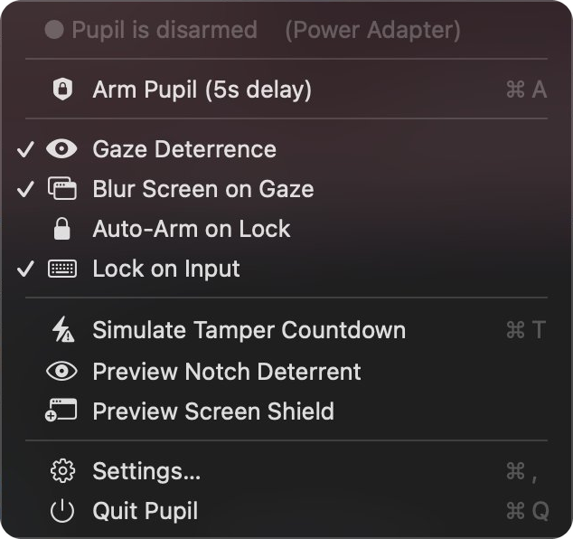
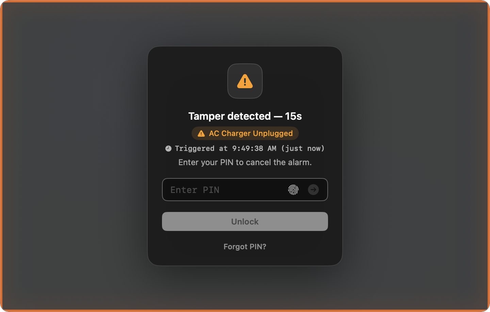
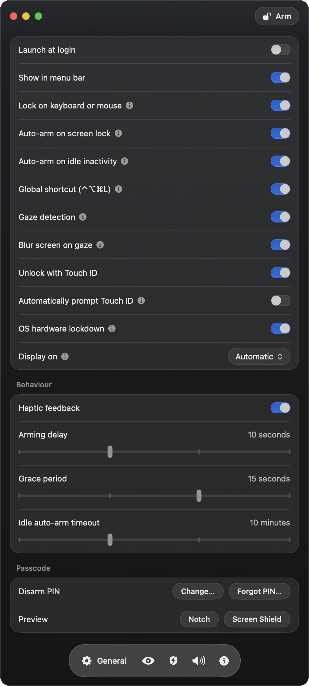
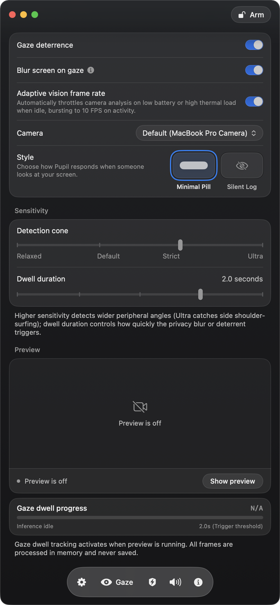
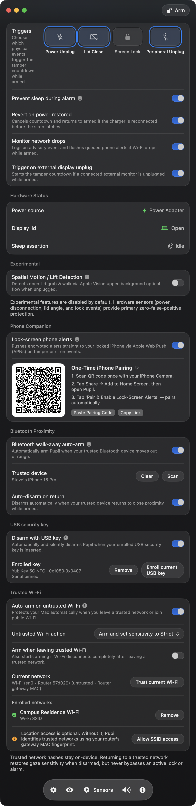
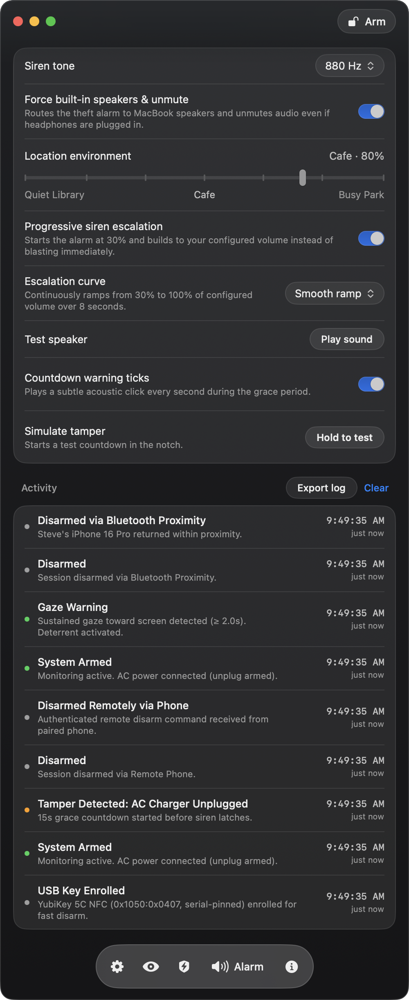

<h1 align="center">
  <br>
  Pupil
  <br>
</h1>

<p align="center">
  <strong>A lightweight macOS menu bar app that watches your Mac when you step away in a library or cafe, blurring your screen if someone peeks and sounding an alarm if someone tampers with your laptop.</strong>
</p>

<p align="center">
  <a href="LICENSE"></a>
  
  
</p>

---

## Who This Is For

* **Students in libraries and study halls** who want to grab a coffee or use the restroom without packing up their MacBook and charger every time.
* **Solo cafe and coworking workers** who want instant screen privacy if someone looks over their shoulder while they work on sensitive notes, code, or exams.
* **Anyone on battery or power** who wants a loud local deterrent and an immediate lock-screen alert on their iPhone if someone unplugs their charger, closes their lid, or moves their laptop.

---

## Download & Install

Building from source is completely optional. Most users can install the prebuilt app in three steps:

1. **Download**: Get the latest **`Pupil.dmg`** from [GitHub Releases](https://github.com/SteveWong-a/pupil/releases/latest).
2. **Install**: Open `Pupil.dmg` and drag **Pupil.app** into your **Applications** folder.
3. **Open**: Launch **Pupil** from Applications, Launchpad, or Spotlight. The settings window opens on first launch, and tucks quietly into your menu bar when closed.

> [!TIP]
> **First-launch Gatekeeper note:** Pupil is not currently notarized with an Apple Developer ID certificate. If macOS blocks it on first launch, Right-click (or Control-click) `Pupil.app` in **Applications**, choose **Open**, and confirm **Open**. Alternatively, run this command in Terminal:
> ```bash
> xattr -cr /Applications/Pupil.app
> ```

---

## Four Response Levels

| Level | When It Triggers | What Pupil Does |
| :--- | :--- | :--- |
| **1. Armed** | You arm Pupil from the menu bar (`⌘A`), Settings, a global shortcut, or auto-arm (screen lock, idle timer, Bluetooth walk-away, or untrusted Wi-Fi). | The menu bar icon flips to armed mode and begins monitoring your charger, lid, screen lock, peripherals, and camera sensors. |
| **2. Gaze Blur & Warning** | Someone looks toward your screen for longer than your chosen dwell time while armed. | Shows a discreet warning pill in the notch (or top of screen) and optionally covers your display in a deep frosted blur until they look away. |
| **3. Tamper Countdown** | Someone unplugs your charger, closes the lid, locks the screen, unplugs an external display or USB device, or lifts the laptop. | Locks the display behind the Screen Shield and starts a countdown. Disarm in time with Touch ID, your PIN, a paired USB key, or your iPhone. |
| **4. Full Siren Alarm** | The countdown expires (or lid close is set to trigger immediately). | Keeps your Mac awake and sounds a loud siren through the built-in speakers until you disarm with Touch ID or your PIN, and pushes an alert to your paired iPhone. |

Keyboard or mouse use while armed locks the screen immediately and asks for your PIN or Touch ID when **Lock on keyboard or mouse** (**Lock on input** in the menu bar) is enabled. It does not start the countdown.

---

## Screenshots

<table>
  <tr>
    <td align="center" valign="top" width="50%">
      <br>
      <sub><strong>Menu Bar Controls:</strong> Arm, toggle gaze blur, preview the shield, or open Settings.</sub>
    </td>
    <td align="center" valign="top" width="50%">
      <br>
      <sub><strong>Screen Shield:</strong> Frosted full-screen lock with Touch ID and PIN disarm during countdown.</sub>
    </td>
  </tr>
  <tr>
    <td align="center" valign="top" width="50%">
      <br>
      <sub><strong>General Settings:</strong> Auto-arm rules, Touch ID, arming delay, grace period, and PIN setup.</sub>
    </td>
    <td align="center" valign="top" width="50%">
      <br>
      <sub><strong>Gaze Detection:</strong> Detection cone, dwell duration, adaptive frame rate, and live preview.</sub>
    </td>
  </tr>
  <tr>
    <td align="center" valign="top" width="50%">
      <br>
      <sub><strong>Sensors &amp; Phone Companion:</strong> Power/lid triggers, iPhone QR pairing, Bluetooth proximity, USB key, and trusted Wi-Fi.</sub>
    </td>
    <td align="center" valign="top" width="50%">
      <br>
      <sub><strong>Alarm &amp; Activity Log:</strong> Speaker routing, environment volume preset, escalation curve, and event log.</sub>
    </td>
  </tr>
</table>

---

## Privacy & How Gaze Detection Works

* **On-device gaze detection:** Video frames are analyzed strictly in memory using Apple's built-in Vision framework. Gaze frames are never saved to disk.
* **Alarm snapshots:** When an alarm fires, Pupil sends one verification photo to your paired iPhone so you can see who is there. No other photos leave your Mac.
* **Camera use:** The camera turns on while Pupil is armed and any camera-based sensor is enabled: gaze detection, lift detection, or surroundings watch. You can also preview the camera manually in Gaze Settings.
* **No face enrollment required:** Pupil does not identify who is looking or store biometric profiles. While armed, any sustained gaze toward your screen triggers the warning and optional privacy blur, and clears automatically as soon as they look away.
* **Adjustable dwell & sensitivity:** Tune the **Detection cone** (`Relaxed`, `Default`, `Strict`, `Ultra`) and **Dwell duration** (`0.5s` to `3.0s`) in **Settings -> Gaze** to fit a quiet corner desk or a crowded cafe table.

---

## Requirements

* **Mac:** `macOS 14.0 or later` (Sonoma or newer) on any Apple Silicon or Intel Mac with a built-in camera (or connected webcam).
* **iPhone Companion (optional):** Any iPhone running **iOS 16.4 or later**. Open the pairing link in Safari, tap **Share -> Add to Home Screen**, and tap **Pair & Enable Lock-Screen Alerts** for remote disarm and lock-screen notifications.

---

## Feedback

Found a bug, have a feature request, or want to report a false-positive edge case? Open an issue at [github.com/SteveWong-a/pupil/issues](https://github.com/SteveWong-a/pupil/issues).

---

## Technical Details (For Developers)

### Native macOS Architecture

* **Dockless Menu Bar Agent (`NSApplication.ActivationPolicy.accessory`)**: Runs quietly in `NSStatusBar.system` without Dock clutter. Opening **Settings (`⌘,`)** reveals the native settings window and returns to `.accessory` mode when closed.
* **System Settings UI**: Built with `NSVisualEffectView` (`.sidebar` vibrancy), unified transparent `NSToolbar`, progressive header blur (`ProgressiveHeaderBlur`), grouped cards, and a floating bottom capsule tab bar with trackpad swipe navigation.
* **Hardware Notch & Dynamic Island Overlay**: Uses a non-activating `NSPanel` at `CGShieldingWindowLevel() + 1` with concave top-corner flares (`NotchShape`) aligned to `NSScreen.auxiliaryTopLeftArea` / `auxiliaryTopRightArea`, falling back to a continuous-corner pill on notchless displays.
* **On-Device Vision & Spatial Lift Detector**:
  * **Iris & Gaze Dwell**: `VNDetectFaceRectanglesRequest` and `VNDetectFaceLandmarksRequest` (`leftPupil`, `rightPupil`, `leftEye`, `rightEye`, `yaw`, `pitch`) capped at 10 FPS (with adaptive throttling via `AdaptiveVisionGovernor`) and configurable dwell timers.
  * **Screen Privacy Blur & Armed Input Sentry**: Full-screen frosted-glass shield (`ScreenShieldWindow` / `ScreenShieldView`) that obscures display contents during gaze alerts or tamper countdowns and challenges for Touch ID or Keychain PIN disarm.
  * **Spatial Lift & Walk Sentry (Experimental)**: Optional battery-power lift detector using upper-background registration (`VNTranslationalImageRegistrationRequest` and `VNHomographicImageRegistrationRequest`) with face masking and transient desk-bump rejection.
* **Keychain & Touch ID Security**: Disarm PINs are salted and SHA-256 hashed in the macOS Keychain (`Security` framework) alongside `LocalAuthentication` Touch ID verification and `PinAttemptLimiter` lockout protection.
* **One-Time QR Phone Companion (Direct W3C Web Push)**:
  * **Zero-Config Lock-Screen Alerts**: Scan an in-app `CoreImage` QR code in **Settings -> Sensors -> Phone Companion** and add the companion web app (`https://stevewong-a.github.io/pupil/`) to your iPhone Home Screen.
  * **Encrypted Delivery**: `WebPushManager` signs RFC 8292 VAPID ES256 tokens and encrypts payloads using native `CryptoKit` (`P256.KeyAgreement` + `HKDF-SHA256` + `AES-128-GCM` per RFC 8291 / RFC 8188).

### Building from Source (Optional)

**Build requirements:**
* `macOS 14.0 or later`
* `Swift 6.0+` (Xcode 16+ or Swift 6 toolchain)

```bash
# 1. Run unit test suite
swift test

# 2. Package single downloadable installer (dist/Pupil.dmg + dist/Pupil.zip)
./scripts/build-dmg.sh

# 3. Launch app bundle or reveal Settings
open "./dist/Pupil.app"
./dist/Pupil.app/Contents/MacOS/Pupil --open-settings
```

### Repository Structure

```text
pupil/
├── Package.swift
├── scripts/
│   ├── bundle-app.sh                   # Compiles release binary and builds Pupil.app
│   ├── build-dmg.sh                    # Packages Pupil.dmg and Pupil.zip with SHA-256 checksums
│   ├── generate-icon.swift             # Generates AppIcon.icns
│   └── generate_embeddings.py          # Generates semantic codebase metadata
├── Sources/Pupil/
│   ├── PupilApp.swift                  # @main App, AppDelegate, NSStatusItem menu bar
│   ├── Core/
│   │   ├── SecurityCoordinator.swift   # State machine: DISARMED -> ARMING -> ARMED -> TAMPER -> ALARM
│   │   ├── PowerAndLidMonitor.swift    # IOKit AC charger, AppleClamshellState & IOPMAssertion
│   │   ├── LockMonitor.swift           # DistributedNotificationCenter lock/sleep/wake monitor
│   │   ├── SirenSynthesizer.swift      # Zero-asset AVAudioEngine dual-tone alarm synthesizer
│   │   ├── KeychainManager.swift       # Salted SHA-256 Keychain PIN & Touch ID authentication
│   │   ├── WebPushManager.swift        # CryptoKit RFC 8291/8292 Web Push & one-time QR phone pairing
│   │   ├── BluetoothProximityMonitor.swift
│   │   ├── TrustedNetworkMonitor.swift
│   │   ├── USBKeyMonitor.swift
│   │   └── ...                         # Hardware lockdown, audio routing, tamper journal & evaluators
│   ├── Vision/
│   │   ├── CameraManager.swift         # AVFoundation capture session (up to 10 FPS)
│   │   ├── AdaptiveVisionGovernor.swift# Battery and thermal frame-rate throttling
│   │   ├── VisionGazeDetector.swift    # Apple Vision landmarks & GazeTemporalAggregator
│   │   └── VisionMotionDetector.swift  # Apple Vision upper-background registration & lift sentry
│   ├── MenuBar/
│   │   ├── MenuBarIconFactory.swift    # Vector menu bar template icons
│   │   └── MenuBarPopoverView.swift    # Quick-arm and toggle popover
│   ├── NotchOverlay/
│   │   ├── NotchGeometry.swift         # Hardware notch & Dynamic Island pill dimensions
│   │   ├── NotchShape.swift            # Concave top-flare notch silhouette path
│   │   ├── NotchWindow.swift           # Shielding-level borderless NSPanel
│   │   ├── NotchOverlayView.swift      # Tracking eye indicator & inline disarm UI
│   │   └── NotchOverlayController.swift# Multi-display notch window lifecycle
│   ├── ScreenShield/
│   │   ├── ScreenShieldWindow.swift    # Shielding-level privacy blur NSPanel
│   │   ├── ScreenShieldView.swift      # Full-screen frosted blur & disarm card
│   │   └── ScreenShieldController.swift# Multi-display Screen Shield manager
│   └── Settings/
│       ├── PupilSettings.swift         # Observable UserDefaults preferences store
│       ├── SettingsWindowView.swift    # Root settings scene with trackpad swipe support
│       └── Pages/                      # General, Gaze, Sensors, Alarm, About tabs
└── Tests/PupilTests/                   # Deterministic unit test suite (swift test)
```

---

## Security & Privacy Disclaimers

> [!IMPORTANT]
> **Educational & Deterrence Tool Only:** Pupil is designed and distributed solely as a software-based anti-theft and anti-shoulder-surfing deterrent. It is **not** an unbreakable physical lock, an insurance policy, or a substitute for personal vigilance. Never leave laptops or sensitive personal property unattended in unmonitored or high-risk public spaces.

> [!WARNING]
> **Hardware & Power Boundaries:** Software sentinels depend on the host operating system remaining powered and running. If a device's battery completely depletes, or if someone forcibly holds down the hardware power button for 10 seconds to force a power-off, software monitoring will terminate. Enable **macOS FileVault full-disk encryption** to protect data at rest.

> [!NOTE]
> **Physical Theft Limitation:** Pupil uses audible sirens, visual notch indicators, and a frosted screen privacy shield to deter opportunists. It cannot physically tether hardware to a table or physically stop someone who carries away a laptop while ignoring the alarm.

---

## Acknowledgments & Credits

* **[Glance (`jonnyoo/glance`)](https://github.com/jonnyoo/glance)** by **Jonathan Zhou**: Pupil's native macOS Settings window architecture (`.sidebar` vibrancy, unified toolbar chrome, progressive header blur, floating bottom capsule tab bar with trackpad swipe navigation, and custom settings controls) and hardware notch geometry patterns are adapted from Glance under the MIT License.

---

## License

Pupil is licensed under the **MIT License**. See [LICENSE](LICENSE) for the full license text and [NOTICE](NOTICE) for third-party copyright attributions.
